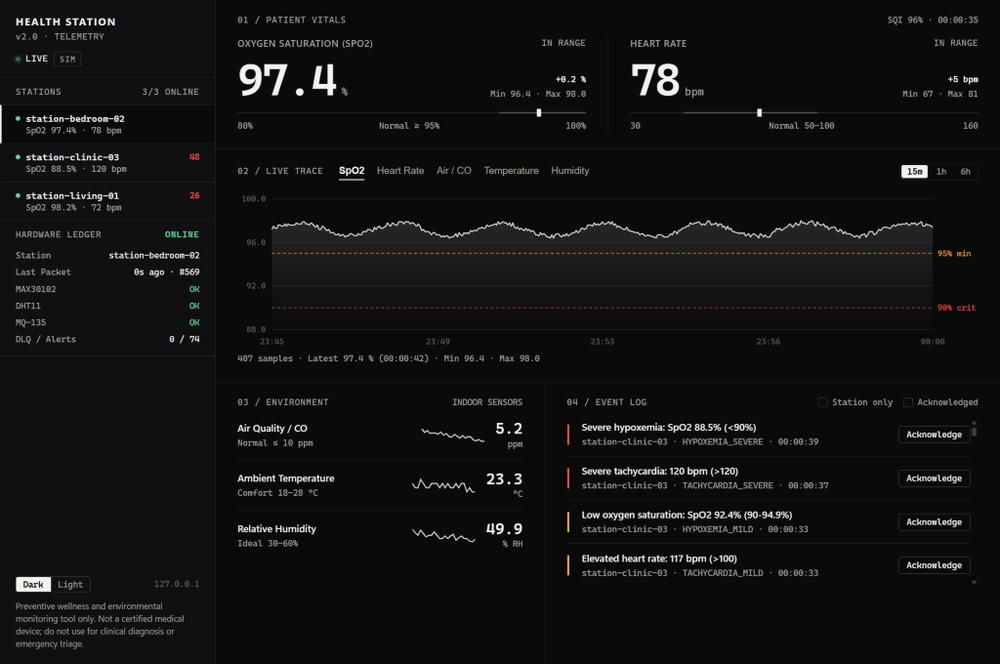
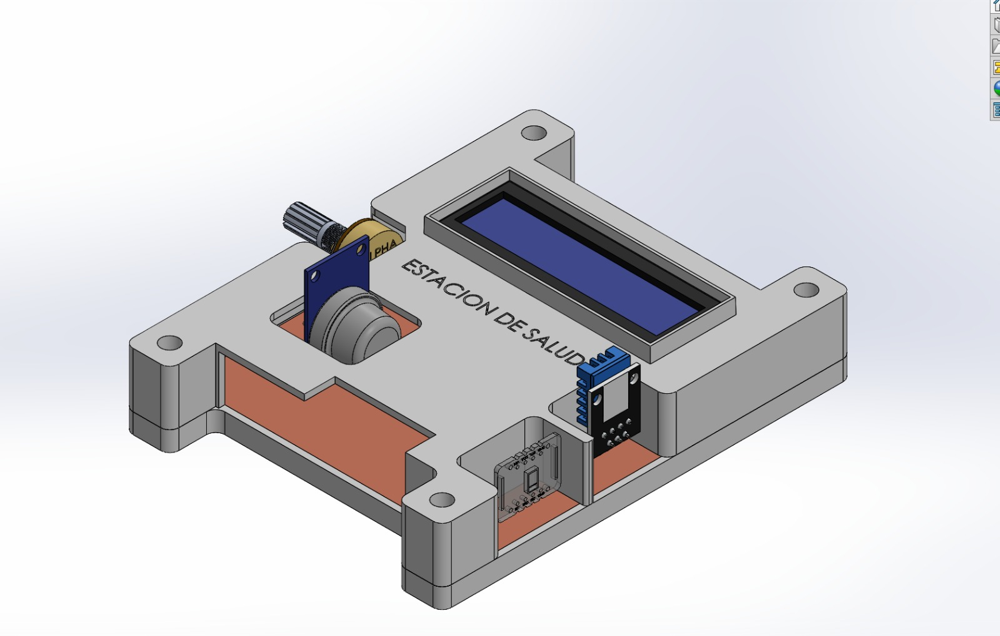
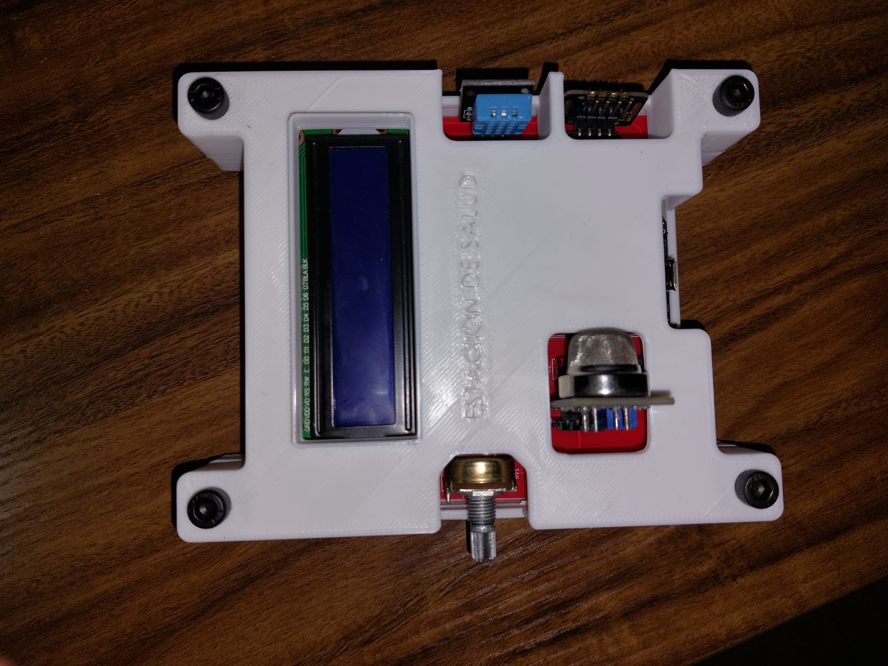
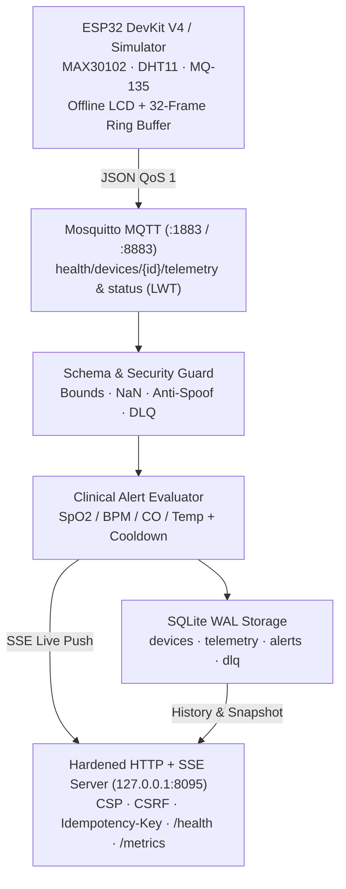

# IoT Health & Environment Monitoring Station (`v2.0`)

[](https://github.com/christianmr1525/IoT_health_station/actions/workflows/ci.yml)


Full-stack biomedical and indoor air-quality monitoring station built around an **ESP32 DevKit V4** edge node, **MQTT (Mosquitto)**, a security-hardened **Python + SQLite WAL** backend, and an offline-first **Clinical Instrument Web UI** with live Server-Sent Events (SSE) — runnable in **1 command without physical hardware** via its built-in multi-station simulator.

> [!IMPORTANT]
> **Preventive Wellness Disclaimer:** This system is an engineering & preventive wellness prototype. It is **not** a certified medical device and must not be used for clinical diagnosis or emergency triage.



---

## Key Features

- **Offline-First Edge Firmware (`Firmware/`)**: Matched 100 Hz MAX30102 FIFO pulse-oximetry sampling with moving average & Signal Quality Index (`SQI`), thread-safe FreeRTOS queue + spinlock separation, local 16×2 LCD updates, 32-frame RAM store-and-forward ring buffer, non-blocking exponential backoff reconnect, and MQTT Last Will & Testament (`LWT`).
- **Hardened Telemetry Pipeline (`backend/`)**: `paho-mqtt` v2 (`manual_ack`), strict JSON schema/physical-bounds/timestamp validation, prototype-pollution & `NaN` rejection, Dead-Letter Queue (`dlq`), `CircuitBreaker`, `IdempotencyStore`, `TokenBucketRateLimiter`, `_LogSanitizingFilter`, and thread-safe SQLite WAL storage.
- **Clinical Instrument Web UI (`backend/static/`)**: Asymmetrical hairline layout (Obsidian Dark & Archival Paper Light), physiological range gauges, clinical Y-axis bounds with dashed threshold lines, interactive SVG hover crosshair, station-scoped alert log, and 1-click alert acknowledgement with strict CSP + CSRF protection.
- **Hardware & CAD Included (`Hardware/`)**: SolidWorks assembly/parts and 3D-printable STL enclosure files for the physical station.

<details>
<summary>Physical Prototype &amp; 3D Enclosure Photos</summary>

| 3D CAD Assembly (SolidWorks) | Assembled Hardware Prototype |
| :---: | :---: |
|  |  |

</details>

---

## Architecture



---

## Project Structure

```text
IoT_health_station/
├── Firmware/                  # ESP32 DevKit V4 firmware (IoT_health_station.ino, filters.h, config.example.h)
├── backend/                   # Python 3.11+ ingestion pipeline, SQLite WAL storage, simulator & HTTP/SSE server
│   └── static/                # Zero-CDN clinical instrument web UI (index.html, styles.css, app.js)
├── Hardware/                  # SolidWorks 3D CAD models & STL enclosure files
├── Photos/                    # Dashboard & physical prototype photos
├── mosquitto/                 # Mosquitto broker config & topic ACLs
├── tests/                     # Unit, clinical-safety, resilience & localhost-security tests
├── Dockerfile                 # Non-root (UID 10001) container image
├── docker-compose.yml         # Mosquitto + backend + optional simulator profile
└── requirements.txt           # Runtime Python dependency (paho-mqtt)
```

---

## Quick Start

### Prerequisites
- **Option A (Local Demo):** Python `3.11+`
- **Option B (Docker Stack):** Docker Desktop / Docker Engine + Compose v2
- **Option C (Real ESP32):** Arduino IDE / PlatformIO + ESP32 board package

### Option A — 1-Command Local Demo (No Docker or Hardware Needed)
Runs an in-process 3-station biomedical/environmental simulator, SQLite WAL storage, and the live SSE dashboard on `http://127.0.0.1:8095`:

```bash
python -m pip install -r requirements.txt
python -m backend.app --demo --open-browser
```
*(On Windows, if `python` is not on PATH, use `py -3 -m ...`.)*

### Option B — Full Docker Stack (Mosquitto + Backend + Simulator)
```powershell
# Windows PowerShell
Copy-Item .env.example .env
docker compose --profile sim up -d --build
```
```bash
# Linux / macOS
cp .env.example .env
docker compose --profile sim up -d --build
```
Open `http://127.0.0.1:8095` in your browser.

### Option C — Real ESP32 Hardware
1. **Install Arduino libraries** in Arduino IDE / Library Manager:
   - `MQTT` (by Joël Gähwiler)
   - `MQUnifiedsensor`
   - `DHT sensor library` (Adafruit)
   - `MAX3010x`
   - `LiquidCrystal` (built-in)
2. **Default GPIO Pinout** (configurable in `Firmware/config.h`):
   | Component | ESP32 Pin(s) |
   | :--- | :--- |
   | **MAX30102 (I2C)** | Default ESP32 I2C (`SDA=21`, `SCL=22`) |
   | **DHT11 (Data)** | `GPIO 23` |
   | **MQ-135 (Analog)** | `GPIO 32` |
   | **LCD 16×2 (4-bit)** | `RS=4`, `EN=5`, `D4=25`, `D5=27`, `D6=14`, `D7=13` |
3. **Configure & Flash**:
   - Copy `Firmware/config.example.h` to `Firmware/config.h` and set your WiFi credentials, `DEVICE_ID`, and MQTT broker host (enable `USE_TLS 1` + port `8883` outside local lab networks).
   - Flash `Firmware/IoT_health_station.ino` to your ESP32 DevKit V4.
4. **Start the backend & Mosquitto**:
   ```bash
   docker compose up -d mosquitto
   python -m backend.app
   ```

---

## MQTT Topics & JSON Contract

- **Telemetry Topic:** `health/devices/<device_id>/telemetry` (QoS 1)
- **Status / LWT Topic:** `health/devices/<device_id>/status` (QoS 1, retained: `{"device_id":"...","status":"online"|"offline"}`)

```json
{
  "device_id": "station-living-01",
  "seq": 42,
  "uptime_ms": 84000,
  "metrics": {
    "bpm": 74.2,
    "spo2_pct": 97.6,
    "signal_quality": 0.94,
    "temperature_c": 23.4,
    "humidity_pct": 46.5,
    "air_quality_ppm": 4.8
  },
  "sensor_status": {
    "max30102": true,
    "dht11": true,
    "mq135": true,
    "mq135_warmup": false,
    "finger_detected": true
  }
}
```
*(The `device_id` in the MQTT topic must match `payload.device_id`; malformed or out-of-bounds payloads are isolated in the `dlq` table.)*

---

## API & Observability Endpoints

| Endpoint | Method | Purpose |
| :--- | :--- | :--- |
| `/` | `GET` | Clinical Instrument Dashboard |
| `/api/session` | `GET` | Session metadata, `csrf_token`, and wellness disclaimer |
| `/api/snapshot` | `GET` | All stations, latest metrics, `online/stale/offline` status, active alert counts |
| `/api/devices/{id}/history?minutes=60` | `GET` | Time-series history (`1..1440` minutes) |
| `/api/alerts?include_acked=false` | `GET` | Active or historical clinical/environmental alerts |
| `/api/alerts/{id}/ack` | `POST` | Acknowledge alert (requires `X-CSRF-Token`, `Content-Type: application/json`; supports `Idempotency-Key`) |
| `/api/stream` | `GET` | Server-Sent Events (`snapshot`, `telemetry`, `alert`, `alert_ack`, `status`) |
| `/health` | `GET` | Health status, MQTT connectivity, circuit-breaker state |
| `/metrics` | `GET` | Prometheus `0.0.4` metrics exposition |

---

## Clinical & Environmental Thresholds

| Metric | Normal | Warning | Critical |
| :--- | :--- | :--- | :--- |
| **SpO2** | `>= 95.0%` | `90.0 – 94.9%` | `< 90.0%` |
| **Heart Rate** | `50 – 100 bpm` | `40 – 49` or `101 – 120 bpm` | `< 40` or `> 120 bpm` |
| **Air Quality / CO** | `<= 10 ppm` | `10.1 – 35 ppm` | `> 35 ppm` |
| **Temperature** | `18 – 28 °C` | `10 – 17.9` or `28.1 – 34 °C` | `< 10` or `> 34 °C` |
| **Humidity** | `30 – 60% RH` | `< 30%` or `> 60%` | — |

---

## Security & Testing

- **Localhost & Browser Hardening**: Bound strictly to `127.0.0.1` by default, Host-header allowlist (anti-DNS-rebinding), strict `Origin` + `Sec-Fetch-Site: cross-site` + `X-CSRF-Token` checks on `POST`, strict `Content-Type: application/json` enforcement (`HTTP 415`), strict CSP (`script-src 'self'`), no wildcard CORS, path-traversal guards, per-IP `TokenBucketRateLimiter` (`HTTP 429`), and `Idempotency-Key` replay/409 protection.
- **Ingestion & Container Hardening**: Regex-validated `device_id`, topic-to-payload anti-spoofing, 16 KB / depth-6 JSON guard, `NaN`/`Infinity` and prototype-pollution key rejection, Dead-Letter Queue (`dlq`), SQLite WAL parameterized queries, `_LogSanitizingFilter`, and non-root `UID 10001` `read_only` Docker containers.
- **Before Exposing Beyond `localhost` (LAN / Cloud Checklist)**:
  1. Place the dashboard behind HTTPS + authentication (OIDC/JWT or reverse-proxy auth) — never expose unauthenticated health metrics on a network.
  2. In `mosquitto/mosquitto.conf`, set `allow_anonymous false`, configure `password_file` + `mosquitto/acl`, and enable TLS on `:8883`.
  3. Set `USE_TLS 1` and `MQTT_BROKER_PORT 8883` in `Firmware/config.h` with your broker CA certificate.

```bash
python -m unittest discover -s tests -v
```
*(14/14 unit, clinical-safety, resilience & localhost-security tests passing; GitHub Actions runs `compileall`, `unittest`, `pip-audit`, and `Trivy`.)*

---

## Hardware v2 Upgrade Roadmap

For real-world deployment beyond the university prototype PCB (`Hardware/`):
- Replace `DHT11` with **SHT41** or **BME688** (I2C, ±0.2 °C accuracy, thermally isolated from MCU/heaters).
- Replace `MQ-135` with **SCD41** (true NDIR CO2) + **SEN55** (PM2.5/VOC/NOx) or an electrochemical CO sensor.
- Replace parallel 16×2 LCD + potentiometer with an **I2C OLED** or **SPI TFT** and enclose the **MAX30102** in an opaque finger clip to block ambient light.

---

## Evolution from v1.0 (University Prototype → v2.0)

| Layer | v1.0 Issues Fixed | v2.0 Solution |
| :--- | :--- | :--- |
| **Firmware (`Firmware/`)** | `vTaskDelay(100)` broke MAX30102 400 Hz filters (~10 Hz real rate); FreeRTOS socket race condition; `while(1)` sensor halts; LCD depended on cloud round-trip; reconnect subscribed to wrong topic; hardcoded `data.h` | Matched 100 Hz FIFO sampling + moving average + SQI; FreeRTOS `xQueue` + `portMUX_TYPE` spinlock (single socket owner); offline-first local LCD; 32-frame RAM ring buffer; non-blocking exponential backoff; JSON + MQTT LWT; `config.example.h` |
| **Backend (`backend/`)** | Opened/closed 2 MySQL connections per MQTT message; broken on `paho-mqtt >= 2.0`; no device ID; no DLQ; no tests | `paho-mqtt` v2 (`manual_ack`); strict schema/bounds/NaN/prototype-pollution validation; Dead-Letter Queue (`dlq`); thread-safe SQLite WAL multi-station storage; `CircuitBreaker`, `IdempotencyStore`, `TokenBucketRateLimiter`, `_LogSanitizingFilter` |
| **Clinical & UI (`backend/static/`)** | SpO2 `>= 90%` marked green (`ok`) and `80–89%` yellow; full page reload every 5 s; no units, no history, no offline badge, `display_errors=1` | Evidence-aligned thresholds (`SpO2 < 90%` critical, `90–94.9%` warning, `>= 95%` normal); live SSE + asymmetrical hairline instrument UI; `ONLINE/STALE/OFFLINE` LWT status; 1-click alert acknowledgement; strict CSP + CSRF + Host allowlist |

## License

[MIT](LICENSE)
