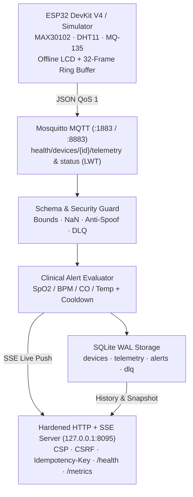

# IoT Health & Environment Monitoring Station (`v2.0`)

Real-time biomedical & indoor air-quality monitoring platform built around an **ESP32 DevKit V4** edge node, **MQTT (Mosquitto)**, a security-hardened **Python + SQLite WAL** backend, and an offline-first **Clinical Instrument Web UI** with live Server-Sent Events (SSE).

> [!IMPORTANT]
> **Preventive Wellness Disclaimer:** This system is an engineering & preventive wellness prototype. It is **not** a certified medical device and must not be used for clinical diagnosis or emergency triage.

---

## What Changed from v1.0 (University Prototype → v2.0 Production Architecture)

| Layer | v1.0 Issues Fixed | v2.0 Solution |
| :--- | :--- | :--- |
| **Firmware (`Firmware/`)** | `vTaskDelay(100)` broke MAX30102 400 Hz filters (~10 Hz real rate); FreeRTOS socket race condition; `while(1)` sensor halts; LCD depended on cloud round-trip; `conectar()` subscribed to `/saludo`; hardcoded `data.h` | Matched 100 Hz FIFO sampling + moving average + SQI; FreeRTOS `xQueue` + `portMUX_TYPE` spinlock (single socket owner); offline-first local LCD; 32-frame RAM ring buffer; non-blocking exponential backoff; JSON + MQTT LWT; `config.example.h` |
| **Backend (`backend/`)** | Opened/closed 2 MySQL connections per MQTT message; broken on `paho-mqtt >= 2.0`; no device ID; no DLQ; no tests | `paho-mqtt` v2 (`manual_ack`); strict schema/bounds/NaN/prototype-pollution validation; Dead-Letter Queue (`dlq`); thread-safe SQLite WAL multi-station storage; `CircuitBreaker`, `IdempotencyStore`, `TokenBucketRateLimiter`, `_LogSanitizingFilter` |
| **Clinical & UI (`backend/static/`)** | SpO2 `>= 90%` marked green (`ok`) and `80–89%` yellow; full page reload every 5 s; no units, no history, no offline badge, `display_errors=1` | Evidence-aligned thresholds (`SpO2 < 90%` critical, `90–94.9%` warning, `>= 95%` normal); live SSE + pure-SVG sparklines & `15m/1h/6h` history charts; `ONLINE/STALE/OFFLINE` LWT status; 1-click alert acknowledgement; strict CSP + CSRF + Host allowlist |

---

## Architecture



---

## Quick Start

### Option A — 1-Command Local Demo (No Docker or Hardware Needed)
Runs an in-process 3-station biomedical/environmental simulator, SQLite WAL storage, and the live SSE dashboard on `http://127.0.0.1:8095`:

```powershell
Copy-Item .env.example .env
python -m pip install -r requirements.txt
python -m backend.app --demo --open-browser
```

### Option B — Full Docker Stack (Mosquitto + Backend + Simulator)
```powershell
Copy-Item .env.example .env
docker compose --profile sim up -d --build
```
Open `http://127.0.0.1:8095` in your browser.

### Option C — Real ESP32 Hardware
1. Copy `Firmware/config.example.h` to `Firmware/config.h` and configure WiFi, `DEVICE_ID`, and MQTT broker settings (enable `USE_TLS 1` + port `8883` outside local lab networks).
2. Flash `Firmware/IoT_health_station.ino` to your ESP32 DevKit V4.
3. Run the backend without `--demo`:
   ```powershell
   python -m backend.app
   ```

---

## API & Observability Endpoints

| Endpoint | Method | Purpose |
| :--- | :--- | :--- |
| `/` | `GET` | Clinical Instrument Dashboard |
| `/api/session` | `GET` | Session metadata, `csrf_token`, and wellness disclaimer |
| `/api/snapshot` | `GET` | All stations, latest metrics, `online/stale/offline` status, active alert counts |
| `/api/devices/{id}/history?minutes=60` | `GET` | Time-series history (`1..1440` minutes) |
| `/api/alerts?include_acked=false` | `GET` | Active or historical clinical/environmental alerts |
| `/api/alerts/{id}/ack` | `POST` | Acknowledge alert (requires `X-CSRF-Token`; supports `Idempotency-Key`) |
| `/api/stream` | `GET` | Server-Sent Events (`snapshot`, `telemetry`, `alert`, `alert_ack`, `status`) |
| `/health` | `GET` | Health status, MQTT connectivity, circuit-breaker state |
| `/metrics` | `GET` | Prometheus `0.0.4` metrics exposition |

---

## Clinical & Environmental Thresholds

| Metric | Normal | Warning | Critical |
| :--- | :--- | :--- | :--- |
| **SpO2** | `>= 95.0%` | `90.0 – 94.9%` | `< 90.0%` |
| **Heart Rate** | `50 – 100 bpm` | `40 – 49` or `101 – 120 bpm` | `< 40` or `> 120 bpm` |
| **Air Quality / CO** | `<= 10 ppm` | `10.1 – 35 ppm` | `> 35 ppm` |
| **Temperature** | `18 – 28 °C` | `10 – 17.9` or `28.1 – 34 °C` | `< 10` or `> 34 °C` |
| **Humidity** | `30 – 60% RH` | `< 30%` or `> 60%` | — |

---

## Hardware v2 Upgrade Roadmap

For real-world deployment beyond the university prototype PCB (`Hardware/`):
- Replace `DHT11` with **SHT41** or **BME688** (I2C, ±0.2 °C accuracy, thermally isolated from MCU/heaters).
- Replace `MQ-135` with **SCD41** (true NDIR CO2) + **SEN55** (PM2.5/VOC/NOx) or an electrochemical CO sensor.
- Replace parallel 16×2 LCD + potentiometer with an **I2C OLED** or **SPI TFT** and enclose the **MAX30102** in an opaque finger clip to block ambient light.

---

## Security & Testing

- **Localhost & Browser Hardening**: Bound strictly to `127.0.0.1` by default, Host-header allowlist (anti-DNS-rebinding), strict `Origin` + `Sec-Fetch-Site: cross-site` + `X-CSRF-Token` checks on `POST`, strict `Content-Type: application/json` enforcement (`HTTP 415`), strict CSP (`script-src 'self'`), no wildcard CORS, path-traversal guards, per-IP `TokenBucketRateLimiter` (`HTTP 429`), and `Idempotency-Key` replay/409 protection.
- **Ingestion & Container Hardening**: Regex-validated `device_id`, topic-to-payload anti-spoofing, 16 KB/depth-6 JSON guard, `NaN`/`Infinity` and prototype-pollution key rejection, Dead-Letter Queue (`dlq`), SQLite WAL parameterized queries, `_LogSanitizingFilter`, and non-root `UID 10001` `read_only` Docker containers.

```powershell
python -m unittest discover -s tests -v
```
*(14/14 unit, clinical-safety, resilience & localhost-security tests passing; GitHub Actions runs `compileall`, `unittest`, `pip-audit`, and `Trivy`.)*

## License

[MIT](LICENSE)
